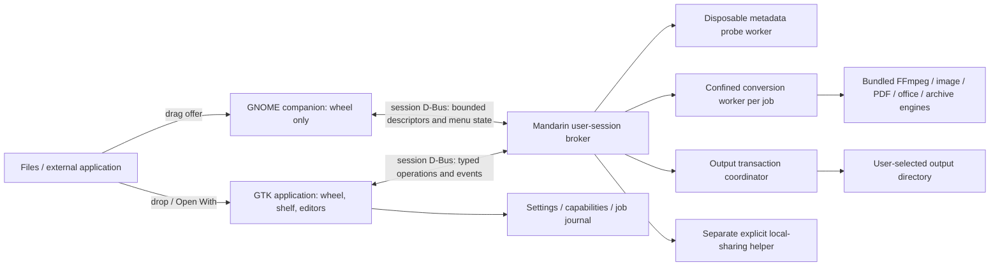

# Mandarin software architecture

Version: 1.0.0 planning baseline. A native 0.1.0 preview now exists. [ADR-006](ADR-006-native-implementation.md) amends the stack/confinement proposal; the [implementation report](../reports/implementation-0.1.0.md) records actual proof and open gates.
Prepared: 2026-10-18. Scope: a self-contained Ubuntu counterpart to Tangerine, with source parity measured per directed conversion and tool behavior.
Decision authority: implementation may refine adapters, but must not silently reduce the interaction, fidelity, offline, or packaging release gates below.

## 1. Product boundary and evidence

Mandarin accepts files or folders, presents context-specific Convert, Tools, and Actions wheels, expands a hovered category into a submenu during the same drag, and executes the selected operation on final release.
The requested nested, spring-loaded wheel is a Mandarin requirement; the source website's simulated demonstration does not prove the Mac application's exact nested navigation behavior.
The source audit identifies 275 directed demo conversion choices, 26 tool IDs, and six actions; a list of extensions alone is not a compatibility specification.
Keep the audited edge inventory separate from the executable capability registry: an advertised edge is a parity obligation, while an enabled edge requires a passing adapter and fixture.
The latest source website describes Shift/Command/Control invocation; older listing text differs. Ubuntu's modifier mapping must be configurable, tested during external drags, and documented as a platform adaptation.
The source feature overview and simulation are vendor claims, not independent performance or conversion-quality evidence. [Tangerine](https://www.tangerineformac.com/)

## 2. Supported deployment and technology decision

Propose Tier 1 support for stock Ubuntu Desktop 24.04 LTS and 26.04 LTS, initially amd64, with arm64 release artifacts only after equivalent hardware validation.
Ubuntu's official notes identify GNOME 46 for 24.04 and GNOME 50 for 26.04; these are verified mappings, not projections from Ubuntu numbering. [24.04 notes](https://documentation.ubuntu.com/release-notes/24.04/) [26.04 changes](https://documentation.ubuntu.com/release-notes/26.04/changes-since-previous-interim/)
Ubuntu 26.04's desktop session runs on Wayland only. XWayland application interoperability belongs in testing, but an X11-only implementation cannot meet this support proposal. [LTS upgrade summary](https://documentation.ubuntu.com/release-notes/26.04/summary-for-lts-users/)
Ubuntu flavors and other compositors receive standalone-window support only until their drag integration is separately qualified; do not label that tier full desktop interaction parity.
Pin the GTK public API baseline to GTK 4.14 and corresponding 24.04-supported libadwaita APIs; do not copy newer API examples without checking their introduction versions.
Ubuntu's Noble archive contains GTK 4.14.2; security/updates revisions may differ, so release evidence records actual VM package versions. [Ubuntu package index](https://packages.ubuntu.com/search?keywords=libgtk&suite=noble)

| Consideration | Rust + GTK4/libadwaita | C++ or Rust + Qt6 |
|---|---|---|
| Ubuntu GNOME integration | Direct GIO, GDK, GTK and libadwaita conventions; fewer translation layers | Good Wayland and drag APIs; additional GNOME styling and GIO integration work |
| Radial drag interaction | GTK async drop target and drag motion controllers; custom hit testing | QDragMoveEvent and QMimeData support live target updates |
| Accessibility | Standard GTK controls plus explicit semantics for custom sectors | Standard Qt controls and accessible interfaces; custom sectors still need explicit semantics |
| Global Wayland invocation | Requires compositor integration for the requested behavior | Same compositor constraint; changing toolkit does not remove it |
| Worker safety | Rust supervisor with small unsafe/FFI surface | C++ requires stronger memory-safety discipline, or separate Rust supervisor |
| Distribution | GTK baseline tied to Ubuntu; full payload can bundle converters | Larger Qt runtime/plugin closure; Noble's archive has Qt 6.4.2 |

Recommend Rust for domain/state/worker control, gtk-rs plus GTK4/libadwaita for application windows, and a deliberately small GJS GNOME Shell companion if feasibility passes.
Qt is a credible alternative if the team has materially stronger Qt expertise; its live drag API is verified, but is not a solution to compositor privileges. [Qt drag events](https://doc.qt.io/qt-6/qdragmoveevent.html) [Ubuntu Qt packages](https://packages.ubuntu.com/search?keywords=qt&suite=noble)
Do not require a web runtime, localhost web server, Python environment, or user-installed conversion utilities for the shipping application.

## 3. Highest-risk gate: global drag interaction on GNOME Wayland

An ordinary Wayland client receives an external drag offer when the pointer enters one of its surfaces; it does not receive every desktop drag or its file payload globally. [Wayland data model](https://wayland.freedesktop.org/docs/book/Protocol.html)
The GlobalShortcuts portal registers shortcut activation/deactivation and may supply an activation token. Its documented interface supplies neither drag payloads nor arbitrary desktop overlay placement. [GlobalShortcuts](https://flatpak.github.io/xdg-desktop-portal/docs/doc-org.freedesktop.portal.GlobalShortcuts.html)
Treat portal support as a runtime-discovered convenience for opening Mandarin's normal window, not as proof that a Shift tap during someone else's drag can create the requested wheel.
GTK distinguishes parent-relative popups from toplevels and removes global-coordinate/move/keep-above APIs; do not assume a GTK Wayland toplevel can be positioned at any global pointer coordinate or stay above all apps. [GTK windowing migration](https://docs.gtk.org/gtk4/migrating-3to4.html)
The possible solution is a GNOME Shell companion owning the compositor-level wheel, coordinating with the user-session broker, while GTK owns shelf/editor/history/settings windows.
This is a hypothesis, not a demonstrated capability: Shell drag hooks, modifier delivery during a compositor drag, payload access, and acceptance completion must all be proven on both supported GNOME majors.
Shell extensions execute within GNOME Shell and have a broad desktop trust boundary; never decode media, render PDFs, run inference, or block on conversion inside the extension. [Extension architecture](https://gjs.guide/extensions/)
Separate versioned extension adapters for GNOME 46 and 50 if required, with tested shell-version declarations; do not claim support by merely appending a version string. [Extension compatibility](https://gjs.guide/extensions/overview/updates-and-breakage.html)

Gate W0 is a time-boxed 5–10 engineer-day investigation, completed before committing the main UI implementation:

1. With Nautilus dragging a real file, tap each chosen modifier, release the modifier, keep the pointer button held, and display a wheel near the pointer without canceling the source drag.
2. Read only the offered URI/file-transfer descriptor; preflight it off the Shell thread, return valid choices, and preserve the drag session while the root wheel becomes a submenu.
3. Traverse category → format → preset, backtrack, then release once; the source receives a completed COPY transfer exactly once and exactly one job is enqueued.
4. Repeat from native GTK, Qt, XWayland, Firefox Snap/Flatpak, and a portal-based sandboxed source; distinguish a URL/text drag from a local-file drag.
5. Verify Escape, pointer exit, source cancellation, rapid modifier changes, extension disable, broker death, lock/unlock, and multi-monitor scale changes leave no input grab or ghost overlay.
6. Verify Shell remains responsive with a 10,000-file offered list and stalled source; overlay latency and preflight deadlines are measured separately.

Deliver W0 as an actual runnable spike, screen capture, event trace, tested package versions, minimal extension/API dependencies, and explicit source-app failures.
If payloads cannot be obtained until drop, show only tentative MIME-based categories before drop; this fails strict context-aware pre-drop parity unless an alternative proves the required behavior.
If the companion cannot safely receive/finish the external transfer, stop claiming global equivalence. A visible drop window, Nautilus action, or file picker is a useful alternative product mode requiring an explicit parity exception.
Do not implement a full-screen transparent pointer-intercepting surface as an unreviewed shortcut; it must pass the same routing, focus, and cancellation checks.

## 4. Containers and trust boundaries



The broker is a normal per-user process activated on demand; no system daemon, privileged converter, or root runtime is permitted.
The Shell companion receives display-safe menu descriptions and status only. File content never crosses into Shell merely to decide a menu.
The broker owns scheduling, input grants, adapter selection, cancellation, staging, final commit, and persisted job state; front ends cannot send arbitrary executable names or argument lists.
Probe workers are as untrusted as conversion workers: media metadata parsers can fail or be exploited before any conversion starts.
Conversion workers receive read-only input grants, a read-only engine/model/font tree, and one private writable staging area; they receive no session bus, network, desktop socket, home tree, SSH agent, or credentials.
The trusted output coordinator publishes validated artifacts after every producer descendant exits; workers cannot write arbitrary destination paths or mutate originals. Independent validators, thumbnail/preview decoders and editor imports also run confined. The broker/coordinator/GTK frontend never load untrusted rich formats merely to inspect or display them; bounded validated display buffers and typed results cross that boundary.
The sharing helper alone may use LAN discovery/transfer, only after an explicit Share action; conversion, metadata probing, and model inference remain network-disabled.

## 5. Protocols and file acquisition

Use a stable app ID such as `org.mandarin.Converter` after name ownership review; protocol names below are provisional, not claimed registered names.
Expose `/org/mandarin/Converter` on the session bus with a versioned `org.mandarin.Converter1` interface; resolve and monitor the unique owner, reject incompatible versions, and enforce per-caller request limits.
No IPC authentication scheme can defend against an already compromised same-user desktop; identify that limit instead of presenting session D-Bus as an isolation boundary against the user account.
Define descriptors as bounded byte arrays (`ay`), Unix FDs (`h`), and typed dictionaries (`a{sv}`) rather than raw filesystem path strings; use a fixed protocol schema and reject unknown option keys/types.
An `InputGrant` contains grant ID, open read-only FD or acquired portal reference, raw basename bytes, display-safe name, source identity, acquisition time, and lifetime; never convert an invalid UTF-8 filename lossily and then use the changed text as a path.

| Method / event | Required contract |
|---|---|
| `GetProtocolVersion()` | Major/minor and supported feature flags; fail closed on unknown major |
| `BeginDrag(session_id, offered_types, descriptor, origin)` | Bounded metadata only; returns drag token; descriptor is URI bytes, portal key, or supported grant reference |
| `GetMenu(drag_token, path, revision)` | Returns immutable items: ID, label, sensitivity, reason, child IDs and capability revision |
| `CommitDrop(drag_token, item_id, options, request_id)` | Validates an armed leaf and grants; creates one idempotent job; never treats hover as commit |
| `LatchCategoryDrop(drag_token, category_id, request_id)` | Retains bounded grants, acknowledges source COPY once, returns selection token and children, creates zero jobs |
| `CommitLatched(selection_token, item_id, options, request_id)` / `ReleaseSelection(token)` | Explicit leaf submission uses retained grants; Escape/timeout releases them; no stale drag token reuse |
| `CancelDrag(drag_token)` | Cancels preflight and invalidates stale menu responses; cannot cancel unrelated jobs |
| `SubmitFiles(input_grants, operation_id, typed_options, request_id)` | Keyboard/picker/Nautilus path into the same validation and execution machinery |
| `CancelJob(job_id)` / `JobChanged` | Monotonic state sequence; terminal outcome is canceled, failed, succeeded, or partially completed |

Use `GtkDropTargetAsync` when explicit transfer limits/cancellation are needed; `GtkDropTarget` preload is possible for typed values but must not indiscriminately load huge advertised payloads. [Async target](https://docs.gtk.org/gtk4/class.DropTargetAsync.html) [Preload semantics](https://docs.gtk.org/gtk4/property.DropTarget.preload.html)
Accept `text/uri-list`, supported `GdkFileList` values, and `application/vnd.portal.filetransfer` via toolkit/portal integration; use a bounded compatibility parser for GNOME copied-file formats only when required by tested sources.
Parse URI lists with a real URI parser, supporting comments/CRLF and percent encoding; never split file paths on spaces or pass URI text through a shell.
Preserve Linux non-UTF-8 filename bytes with `OsStr`/byte-aware filesystem APIs through workers and journal encoding; if a source URI/toolkit cannot represent a name, return a safe explicit representation error without mutation.
Allow local `file:` URIs with empty or localhost authority and valid absolute paths; reject remote authorities and non-file schemes from conversion instead of silently downloading content.
For portal transfer MIME, retrieve paths with `org.freedesktop.portal.FileTransfer.RetrieveFiles(key, {})` on `org.freedesktop.portal.Documents`; the key is not a filename. [FileTransfer](https://flatpak.github.io/xdg-desktop-portal/docs/doc-org.freedesktop.portal.FileTransfer.html)
Portal retrieval can consume an autostop transfer and grants need not survive sessions: cache the acquired grant once per drag and retain open descriptors or stage accepted inputs before acknowledging completion.
Pre-drop portal access from Shell on behalf of another client needs explicit proof; do not assume a key retrieved by Shell automatically grants a different sandboxed recipient identical access.
Preflight limits start at 1 MiB descriptor bytes, 10,000 entries, bounded stat concurrency, and a 500 ms soft menu deadline; benchmark and adjust with explicit rationale.
Open regular files read-only, reject devices/FIFOs/sockets, classify directories separately, deduplicate by stable identity, and verify identity again before execution; do not trust filename extensions alone.
After a committed drop, `gdk_drop_finish(COPY)` follows successful descriptor/input-grant acquisition, not completion of a long conversion; emit a user-visible error if later work fails. [GTK drop completion](https://docs.gtk.org/gtk4/signal.DropTargetAsync.drop.html)

## 6. Radial state machine and accessible UI

Continuous-drag state is `Idle → DragOffered → PreflightPending → Wheel(path) → LeafArmed → DropAccepted → Queued`. Category release instead follows `Wheel(category) → AcquiringGrants → LatchedSelection(children)`, acknowledges source COPY once after acquisition, and creates zero jobs. A later explicit leaf selection uses the same job validation; Escape or bounded selection expiry releases grants without output. Cancellation leaves pre-commit states without file mutations.
Each drag has a monotonically increasing generation; late URI/probe/capability results cannot repaint a different drag's wheel or change its armed leaf.
Use one persistent input surface/widget tree while the submenu changes, with a stable center, breadcrumb/back sector, center dead zone, and angular hysteresis to prevent boundary flicker.
Propose a 250 ms hover dwell for category expansion, adjustable within accessible preferences. Expansion clears the armed leaf and requires at least 8 logical pixels of fresh movement from the transition point into a child sector, or explicit keyboard/click choice, before re-arming. A stationary pointer followed by immediate release cannot execute the child newly drawn underneath it. Back/More and context-generation replacements use the same guard.
Release on a category performs no conversion and latches its children for click/keyboard continuation, as required by REQ-UI-003; release on loading/gap/disabled leaves performs no conversion and clearly explains the outcome.
Final release freezes operation/options/input snapshot; workers revalidate capability revision and input grants before starting.
Use one operation model for Shell wheel, GTK wheel, keyboard list, and editor tools; maintain fixed category ordering rather than learning file-specific layouts that move targets unpredictably.
Mixed selections enable the intersection of valid batch edges; explicit grouping may offer “process compatible files” only with a count and skipped-file explanation.
Construct accessible sectors from semantic controls where possible, expose names/reasons/progress, and provide a complete list view, arrow/Enter/Escape navigation, high contrast, reduced motion, and large targets.
GTK standard controls have built-in accessibility; painted custom sectors require their own semantic and keyboard behavior. Orca testing is a release requirement, not inferred from using GTK. [GTK accessibility](https://docs.gtk.org/gtk4/section-accessibility.html)
Design specifications and actual interface implementation remain future work; this architecture does not claim a visual design audit or a working UI.

## 7. Capability graph, probes, and fidelity

Represent a format node with MIME, container, codec/profile constraints, page/document kind, alpha/animation/color properties, and encrypted/protected status as applicable.
Represent each directed edge with `edge_id`, source predicate, destination specification, adapter/version, required probes/assets, input cardinality, option schema, loss flags, validators, fixtures, and parity source ID.
Conversion chains require an explicit composed edge and fidelity contract; a path through PNG is not proof of editable SVG support, nor is PDF rendering proof of editable DOCX reconstruction.
Probe bundled tools at build/test time and startup after bundle changes: versions, FFmpeg demuxers/muxers/decoders/encoders/filters, image loader/saver availability, LibreOffice filter inventory, PDF helpers, archive formats, and model checksums.
Keep startup smoke fixtures tiny and deterministic; cache results by exact binary, library, asset, and probe-schema hashes. Presence on PATH is insufficient.
Installed codecs are a conjunction: input decoder + output encoder + container compatibility + selected options + smoke conversion. A missing HEIC/AVIF codec disables affected directed edges with a reason.
Use bundled engine paths only for the tested release; optional system adapters appear as an explicitly different, separately tested capability profile.

| Domain | Proposed adapters | Mandatory fidelity contract / unresolved work |
|---|---|---|
| Images | libvips or restricted image worker, libheif/AVIF, SVG renderer | Orientation, alpha, ICC, bit depth, animation, EXIF policy; SVG input rasterization is labeled |
| Audio/video | FFmpeg + ffprobe, CPU baseline | Container versus codec distinction, tracks, language, subtitles, duration, loudness, exact versus keyframe trim |
| PDF structure | qpdf plus bounded renderer | Page count/order/boxes, encryption, annotations, signatures invalidation; output structural validation |
| Office/slides/sheets | Bundled LibreOffice + fonts; controlled export filters | Fonts, pagination, tables, formulas, links, slide objects; page rendering differs from semantic conversion |
| PDF → editable formats | Dedicated offline reconstruction adapter, OCR/layout when required | Separate text, table, reading-order and editability tests; cannot promise fidelity from generic office import |
| Text/Markdown/EPUB/HTML | Structured document adapter, local asset resolver | Encoding, links, heading hierarchy, embedded assets, no remote resource fetching |
| SRT/VTT | Bounded parser/serializer | Timestamp and cue preservation, markup policy, encoding and multiline semantics |
| Archives | libarchive / vetted RAR reader | Format-specific limits; no absolute paths, traversal, devices, escaping symlinks or expansion bombs |

LibreOffice offers headless conversion with named filters and an isolated user profile; its availability does not establish every requested edge. [CLI parameters](https://help.libreoffice.org/latest/en-US/text/shared/guide/start_parameters.html)
Pages export is unresolved: LibreOffice documentation states Pages can be opened but not saved/exported; modern Pages variants must be independently tested. Never rename DOCX as `.pages`. [LibreOffice format caveat](https://documentation.libreoffice.org/assets/Uploads/Documentation/en/GS7.3/GS73-GettingStarted.pdf)
RTFD is a package containing text and attachments, not just an RTF extension; preserve attachments in supported exports or label losses, and reject unsupported package variants. Mac text clippings require their own decoder/fixtures.
PDF → DOCX/PPTX/XLSX/EPUB/Markdown is semantic reconstruction. Scans, tables, columns, equations, ligatures and reading order require scored fixtures; bitmap-only documents must never count as editable output parity.
Reference all 275 directed edges in the parity matrix, including blocked ones. Full parity requires fixture evidence for each edge and all 26 tools; a reduced first release is explicitly scoped.

## 8. Tools and six platform actions

Implement 26 tools through the same typed operation registry: compress, removeMetadata, editImage, annotateImage, frameImage, cropImage, normalizeAudio, muteVideo, trimVideo, splitPDF, organizePDF, extractArchive, createPDF, mergePDF, cropVideo, changeVideoSpeed, joinVideos, videoSnapshots, splitVideo, audioToVideo, trimAudio, audioChannels, createCollage, redactImage, redactVideo, and redactAudio.
Tools with parameters open a GTK editor after drop; cancellation produces no committed file. Preview work runs in cancellable workers and is keyed by source/operation/parameter hash.
Image editing/annotation/composition needs a documented render pipeline, color handling and export-quality checks; a generic backend command does not complete its editor UX.
Redaction exports remove or re-encode selected content; opaque preview rectangles alone do not satisfy redaction. Metadata removal and PDF page operations need artifact inspection, not a visual-only test.
QR reading mentioned outside the 26-tool source catalog is a separate unverified scope item until reconciled; do not silently alter the count.

| Source action | Ubuntu implementation requirement |
|---|---|
| AirDrop | “Share Nearby” as a functional counterpart: bundled local peer discovery/transfer UI, explicit recipient approval and authenticated/encrypted transfer; no Apple AirDrop wire-compatibility claim |
| Float | Shelf retains file grants and offers outbound drag; edge pinning/always-visible behavior needs the GNOME companion gate; regular floating window is a separately described fallback |
| Copy | Clipboard file payloads interoperable with Files and portal recipients; retain ownership/grants until paste or replacement |
| Move | Explicit destination, no-replace publication and a separately reviewed source-ownership/removal transaction; verified copy alone never authorizes path-based deletion; uncertain source state yields inspectable incomplete Move with source retained |
| Copy Path | One local path per line as plain text, with correct Unicode/escaping expectations; portal-exported paths are labeled when no original path is available |
| Terminal | Launch configured trusted terminal adapter with an argument-vector working directory; never interpolate a path into a shell command |

All actions remain available for mixed selections, folders and unconvertible files when their own prerequisites pass; nearby sharing is the explicit network exception to offline conversion. For Terminal with multiple parent directories, show a chooser of unique parents and open one selected directory by default; opening several requires an explicit user choice, never an unbounded terminal launch per file.
AirDrop recipient interoperability and proprietary macOS APIs are not deliverable equivalence guarantees; the release notes must identify the functional platform substitutions.

## 9. Execution, cancellation, and output transactions

Adapters build validated argument vectors, never shell strings; reject unknown options, choose exact executables from the read-only bundle, clear dangerous inherited environment variables, and use fixed local input names when necessary.
Every job has a private mode-0700 workspace and an independent process group, closed inherited descriptors, bounded stdout/stderr drains, wall-clock deadline, memory/CPU/open-file/file-size limits and decoded-content quotas.
Restrict FFmpeg protocols as well as networking, since malicious playlists/documents can reference local or network resources; disable office macros and external-link updates and supply a job-private LibreOffice profile.
For FFmpeg, use noninteractive operation, machine-readable progress, explicit stream mapping/codec policy and no-overwrite options; process exit alone is not output validation. [FFmpeg CLI](https://ffmpeg.org/ffmpeg.html)
Cancellation marks intent, stops queued work, requests cooperative process-group shutdown, and escalates through a verified whole-job boundary before draining/reaping and removing unpublished staging artifacts. Process groups alone cannot contain children that call setsid. S0 must select and prove a stock-compatible PID-namespace/cgroup lifecycle with aggregate memory/CPU/process/thread/output/workspace quotas, including user-manager delegation requirements. No validation/publication starts while any producer retains writable artifacts. If cgroups are used, workers cannot reassign themselves; whole-tree termination is tested independently of group membership.
Default scheduler: two light jobs or one heavy media/office/image/PDF job globally, with a configurable weighted pool; office jobs also have a singleton limit. Avoid spawning one process per selected file without a global resource budget.
Journal states are `queued, running, validating, publishing, succeeded, failed, canceling, canceled, partial`; persist transition IDs so restart never duplicates a publication.
On startup, detect abandoned running jobs and workspaces; mark interrupted, offer retry, and clean stale staging only after proving it belongs to Mandarin.

1. Select output directory/grant before execution; default beside the source only when writable, otherwise prompt once for a destination.
2. Open destination as a directory descriptor and validate its identity; allocate unique hidden staging paths on the destination filesystem so publication can be atomic.
3. Copy or stream validated worker output into staging with exclusive creation; never let a worker guess or reserve the final user-visible name.
4. Validate format/content and expected pages/streams/files in fresh confined validator workers with scoped read-only artifact grants and bounded typed results. The trusted coordinator checks source identity and filesystem policy without decoding rich content, then flushes staged data. Distrust producer manifests: resolve only below staging descriptors, reject unexpected members, absolute/parent paths, devices/FIFOs/sockets, unsafe links and unauthorized hard links; publish only accepted artifact types after all producer descendants exit.
5. Publish each file using atomic no-replace semantics such as Linux `renameat2(RENAME_NOREPLACE)`; if unsupported, use a tested no-clobber strategy, never plain overwriting rename. [Linux rename contract](https://man7.org/linux/man-pages/man2/rename.2.html)
6. On a collision, choose a unique suffix atomically or ask according to policy; an existence check followed by an overwriting write is not safe.
7. Record published artifacts and flush the destination directory as required; only then report success. Conversion preserves the original; the separate Move action has its own verified relocation contract.

A set of unrelated output filenames cannot be atomically renamed as a batch; publish a containing directory when appropriate, otherwise journal each file and report partial completion honestly.
Cancellation after publication preserves already committed outputs and reports them; it must not race into deleting user-visible files or deleting moved originals before verification.
Move needs a separate source-ownership/removal design before ACT-004 qualifies. Evaluate a recoverable no-clobber source-volume claim/quarantine transaction anchored by open directory FDs; verify the claimed object against the granted identity/content, journal every claim/publication/removal boundary, and retain unexpected or changed objects. Check-then-unlink is prohibited as proof of identity: an open FD does not freeze a path or content. Define supported source-concurrency/filesystem assumptions, and qualify both same-filesystem files/directories and cross-filesystem complete member transfers. If safe ownership/removal cannot be established, keep the source or recoverable held object, retain the verified destination, report incomplete Move and show recovery paths; never delete a replacement or report full success. A source modified during/after copy and a directory gaining entries must be explicit fault cases.

Archive extraction lists entries as bounded preflight, then enforces actual byte/count/depth/time/workspace/expansion quotas during writing/decoding, including sparse-file accounting. Use a fresh confined tree; reject escaping paths/symlinks, hard links by default, forward/duplicate entries that change node type, and special nodes. Do not restore owner IDs, setuid/setgid, file capabilities or security-sensitive xattrs. Password/error/cancel cleanup and final-tree validation follow the same output transaction rules; manifest size claims are never the enforcement boundary.

## 10. Security and privacy release boundary

Use a confined worker launcher with mount/read-only input restrictions, seccomp, no-new-privileges and network denial; test containment, rather than assuming separate processes are a sandbox.
Ubuntu 24.04+ restricts unprivileged user namespaces through AppArmor. A bundled bubblewrap-like launcher can fail on stock systems; packaging must supply a reviewed compatible policy or an alternative confinement design. [Ubuntu security guidance](https://documentation.ubuntu.com/security/security-features/privilege-restriction/apparmor/)
Never recommend globally disabling AppArmor/user-namespace restrictions, running converters as root, or silently falling back to unconfined conversion as the shipping solution.
Treat the worker-confinement proof as release gate S0: hostile fixtures cannot read an unrelated home file, write outside staging, connect to network, reach the session bus, or survive cancellation as descendants.
Source parsing and preview codecs are kept patched through release rebuilds; maintain a dependency/model SBOM and license inventory, including codec-dependent redistribution terms.
Settings/job journals contain minimal local metadata; raw file content and file paths are excluded from telemetry, and diagnostics export is explicit and previewable.
Do not promise secure deletion on SSD/copy-on-write filesystems; document temporary-data retention and clean application-owned staging promptly.

## 11. Self-contained packaging and offline operation

“Self-contained” means a downloaded full payload contains every converter, codec, filter, font, model and language asset needed for its declared capability profile, with no first-run downloads or apt/pip/npm installs.
It still relies on the documented Ubuntu kernel/display/desktop baseline. A GNOME companion is an explicit desktop integration component, not something an AppImage can assume already exists.
Build on the oldest supported Ubuntu baseline and test the exact payload on each supported release; hash-lock assets and binaries, and preserve notices/source offers required for redistribution.
Ship a full-payload `.deb` as the primary Ubuntu artifact: application and engines under a private versioned prefix, desktop file, D-Bus activation, icons, AppStream metadata, and reviewed confinement/integration files.
Package installation may use the OS installer with administrator privileges; running Mandarin, converting, updating user settings, and using its companion never requires root.
Bundle LibreOffice runtime/filter closure and redistributable fonts, not merely `soffice`; Ubuntu's minimal desktop need not have LibreOffice installed. Isolate its runtime libraries and per-job profile from host office installations.
Bundle CPU-compatible model inference and all required weights/tokenizers/language data for face/text detection, OCR or reconstruction. Record architecture, hash, version, license, minimum RAM and fallback behavior per asset.
If models are separated into an optional capability pack, publish a combined complete offline distribution and do not advertise those features for the base pack alone.

| Format | Role and constraints |
|---|---|
| Full-payload deb | Recommended initial ship path; reliable Ubuntu installation, policy files and uninstallation; produce/test separate target builds if ABI differences require it |
| AppDir / tar.zst | Useful zero-install offline evaluation; include launch wrapper and all engine resources, but confinement/desktop integration still must pass on stock Ubuntu |
| AppImage | Secondary portable artifact after proving FUSE or extraction path, resource relocation and worker confinement; bundling a library does not install a Shell extension |
| Flatpak | Attractive sandboxed standalone mode; unrestricted Move/Terminal/edge shelf and companion coordination need explicit grants/host integration; do not bypass with broad home/session-bus access |

AppImage guidance requires compatible base-system dependencies and notes Ubuntu 24.04's FUSE package naming; test a clean machine with no FUSE2 dependency already installed. [AppImage best practices](https://docs.appimage.org/reference/best-practices.html) [FUSE constraints](https://docs.appimage.org/user-guide/troubleshooting/fuse.html)
A single `.flatpak` does not contain runtime dependencies. An offline Flatpak delivery needs the complete app/runtime/extension closure via an offline repository or supported USB distribution workflow. [Flatpak offline bundles](https://docs.flatpak.org/en/latest/single-file-bundles.html)
Keep conversion workers without network permissions even if an optional sharing component exists; Flatpak's default isolation supports that principle but does not by itself implement per-job filesystem grants. [Flatpak permissions](https://docs.flatpak.org/en/latest/sandbox-permissions.html)
The full offline payload size is deliberately not estimated as a small installer: measure compressed/download/install/temporary-space size after engines and assets are selected.
Verify disconnected clean-VM install, first launch, every declared edge/tool, and uninstall/reinstall; report missing desktop prerequisites before accepting jobs.

## 12. Build sequence, traceability and unresolved decisions

Implement in dependency order: W0 global interaction spike and S0 confinement spike → typed file grants/state/registry → one image and one media edge with transactions → complete operation families → editors/shelf/actions → full offline package → parity certification.
The first runnable vertical slice must include a real external drag, nested submenu change, validated conversion, collision-safe output, cancellation, and a packaged launch; a painted wheel alone is insufficient.
REQ-UI-001..010 map to wheel state, invocation, hover/back navigation and accessibility; REQ-CTX-001..005 map to grant preflight and capability predicates.
REQ-JOB-001..007 map to supervisor, progress, cancellation, transactions and recovery; NFR-001..012 map to measurable performance, containment, offline delivery, accessibility and support matrices.
UC-001/002 exercise external invocation and nested navigation; UC-003 capability intersections/cardinality; UC-004 editors; UC-005 actions; UC-006 keyboard/picker alternatives; UC-007 job control/recovery; UC-008 offline installation and health.
Use the authoritative SRS and machine inventory to preserve CONV-001..275, TOOL-001..027 and ACT-001..006 traceability; implementation evidence joins by stable ID, not display label.
Full release approval requires both supported Ubuntu versions, W0/S0 evidence, every audited directed edge and tool accounted for, six platform actions tested, hostile-input tests, real-source drag interoperability, offline install proof, and accessible keyboard/screen-reader flows.
Open decisions with blocking owners: desktop integration engineer proves W0; security/packaging engineer proves S0; document-conversion specialist resolves modern Pages input/output and PDF reconstruction fidelity; release engineer closes codec/model licenses and payload closure.
If Pages output or semantic reconstruction lacks a legal, offline, testable implementation, record the blocked edges and obtain an explicit scope decision; “complete equivalence” remains unachieved.
No go-to-market wording may turn tentative adapters, simulated reference interactions, file-extension recognition, or fallback workflows into claims of implemented or certified parity.

## 13. Domain model, storage and test seams

The following are design contracts, not existing Rust declarations or implemented database migrations.

| Entity | Required fields and invariants |
| --- | --- |
| InputGrant | Opaque ID, raw basename bytes, safe display name, owned FD/portal reference, device/inode/size/mtime identity, regular-file/directory classification, acquired time and expiry; no unbounded content in IPC |
| CapabilityEdge | Stable CONV/TOOL/ACT ID, typed source predicate, destination/container/codec, cardinality, adapter/hash/profile, typed option schema, loss flags, prerequisites, validators and fixture IDs |
| MenuSnapshot | Drag token, generation, capability revision, path/breadcrumb, immutable item IDs, labels/reasons, children and operation references; never executable commands |
| Job | UUID, idempotency key, input grant IDs, operation ID, option/profile hash, monotonic state/sequence, output transaction ID, progress and bounded error code; no arbitrary argv from UI |
| OutputTransaction | Open destination directory identity, private staging descriptor, expected artifact manifest, source identity, reserved publication name and committed artifact journal |
| UserPreferences | Schema version, shortcut/dwell/UI/output/quality/metadata/resource policy; validated defaults; no shell snippets or unrestricted executable search path |

The broker owns the job journal and authoritative capability cache. Use local SQLite transactions with versioned migrations for job transitions/publication records; raw filenames are byte-safe BLOBs or explicit reversible encoding. Store settings/journal under XDG config/state directories with user-only directory permissions; cache disposable previews under XDG cache and private workspaces under the user runtime directory or selected volume as appropriate. Do not persist file contents in the journal. Retention is configurable, local and clearable; no conversion histories or paths in telemetry. Companion/shelf references expire when grants are invalid and are revalidated before drag-out. Atomic publication and journal state can diverge on sudden power loss: recover by checking recorded destination identity and expected content, never blindly rerunning a published job.

| Interface | Proposed operations | Verification boundary |
| --- | --- | --- |
| DesktopBridge | begin/cancel drag; show menu snapshot; commit token/leaf | Fake event streams for reducer tests; actual GNOME/source apps for W0/E2E |
| FileGrantProvider | acquire offered descriptor; open allowed input; revalidate identity | Real local/portal grants in integration; expired and replaced-source failures injected |
| CapabilityRegistry | resolve selection/options; return reasons/revision | Pure deterministic tests plus bundled-engine smoke fixtures |
| Adapter | probe(input, limits); plan(operation, options); validate(artifact manifest) | Real engines/output consumers for content claims; fake exit/hang only for supervisor fault tests |
| WorkerLauncher | spawn scoped adapter; progress; terminate whole job and account aggregate resources | Actual confinement/descendant/denial fixtures; no mocked sandbox certification |
| OutputStore | stage; validate manifest; publish no-replace; recover transaction | Real filesystem/mount collision/crash tests with injected boundaries |
| JobStore | append state with sequence; query/recover interrupted jobs | Real SQLite migrations/transactions; deterministic clocks for retention |

## 14. Critical sequences

```mermaid
sequenceDiagram
  participant S as Source app
  participant E as GNOME companion
  participant B as Broker
  participant P as Confined probe
  S->>E: External drag offer + invocation (W0 proof required)
  E->>B: Bounded descriptor, drag token and generation
  B->>P: Acquire scoped input and inspect
  P-->>B: Context and available edges
  B-->>E: Immutable menu snapshot
  E->>B: Category path after dwell
  B-->>E: Child snapshot; same drag stays active
  E->>B: Leaf release + unique request ID
  B-->>E: Input acquired and one job queued
  E-->>S: COPY transfer accepted exactly once
```

```mermaid
sequenceDiagram
  participant U as App/list/editor
  participant B as Broker
  participant W as Confined worker
  participant O as Output coordinator
  U->>B: Typed operation and final parameters
  B->>W: Read-only grants + private staging + limits
  W-->>B: Bounded progress; completed artifact manifest
  B->>W: Independently validate in fresh confined worker
  W-->>B: Bounded typed validation result
  B->>O: Stage validated artifacts on destination volume
  O->>O: Atomic no-replace publication + journal
  O-->>B: Complete/partial output manifest
  B-->>U: Terminal state and revealable outputs
```

```mermaid
sequenceDiagram
  participant U as User
  participant B as Broker
  participant W as Whole-job containment
  participant J as Journal/staging
  U->>B: Cancel job
  B->>J: Persist cancel intent
  B->>W: Cooperative TERM then bounded whole-job kill
  W-->>B: Reaped descendants
  B->>J: Remove unpublished owned artifacts; retain published files
  B-->>U: Canceled/partial state and retained outputs
  Note over B,J: Restart inspects publication records; no automatic duplicate rerun
```

## 15. Decision log and dependency freeze

| Decision | Choice and rationale | Revisit gate |
| --- | --- | --- |
| ADR-001 | Rust/GTK4/libadwaita for native GNOME UI and memory-safe supervisor; toolkit cannot solve compositor privilege | M0 team expertise/ABI and W0 results |
| ADR-002 | Minimal matched GNOME companion for global wheel; GTK owns editors/settings | W0, each Shell major qualification |
| ADR-003 | Explicit directed capability registry and independently validated outputs | Every adapter/profile addition |
| ADR-004 | Full-payload deb for offline engines and narrowly reviewed confinement policy | S0 and clean-VM install |
| ADR-005 | No-overwrite transactions, descriptor-based grants and confined probes/converters | Safety review before every release |

Exact dependency versions/build flags and selected component/model licenses are not yet frozen. M0 creates the authoritative lock/manifest for Rust, gtk-rs, GTK 4.14-compatible API/runtime, libadwaita, GJS companion APIs, SQLite, FFmpeg/ffprobe, image/HEIF/AVIF/SVG libraries, PDF helpers, LibreOffice, document/OCR/layout adapters, libarchive, QR decoder and sharing implementation. Each entry needs source URL/revision/hash, patches, build configuration, transitive runtime closure, supported CPU, license/notices/source obligations and maintenance owner. Candidate alternatives in this architecture are not approved dependencies. Review actual upstream licensing/build configuration before selecting and distributing them; do not infer an engine's effective license from its name.

## 16. Open questions and review incorporation

| Question | Owner | Required resolution |
| --- | --- | --- |
| External native/XWayland drag access, pre-drop context and completion | Desktop engineer | M0 W0 runnable proof or architecture revision |
| Stock Ubuntu worker isolation and required package policy | Systems/release | M0 S0 denial tests and offline package proof |
| True Pages writer/read versions, legacy packages and editable PDF reconstruction | Document/product | M0 P0 feasibility and M4 per-route fidelity |
| Local recipient sharing protocol/implementation and product equivalence | Desktop/product | M0 contract; M5 interoperability qualification |
| Public namespace/license/signing/distribution channel and staffed ownership | Product/release | Before first public build publication |

Review findings and their resolutions are retained with the archived planning reviews; the artifact index links the final baseline and review evidence. Baselining this design records the plan, not proof that the open gates passed.

| Review | Incorporated resolution | Final disposition |
| --- | --- | --- |
| Security SEC-001..005 | Confined validators/editor imports; bounded hostile-output manifests; Move source-ownership/removal gate; whole-job descendant/aggregate control; signature trust lifecycle; live archive/link/metadata limits | Approved planning baseline after targeted verification |
| Requirements REQ-REV-001..006 | Exact demo singleton/batch observations; category-drop retained grants/COPY state; explicit child re-arm; Join MP4 contract; action observation classification; multi-parent Terminal choice | Approved planning baseline after targeted verification |
| Test/release TR-001..005 | Confined output validators; publication/Move crash cases; OFFLINE/LAN-SHARE profiles; per-tool modes and signal/content metrics; M0 sampling/timebox and re-estimation | Approved planning baseline after targeted verification |
