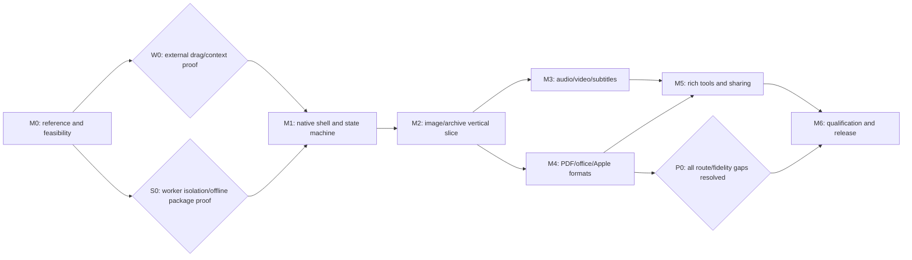

# Mandarin end-to-end delivery plan

Planning baseline: 2026-10-18 · Version 1.0.0. The user subsequently authorized construction. A native 0.1.0 preview now exists; [implementation evidence and open gates](.aiwg/reports/implementation-0.1.0.md) supersede the original progress assumptions below. Full equivalence remains the release objective.

## Outcome

Ship a self-contained Ubuntu application that converts and edits local files through a context-aware radial menu. A continuous drag can enter a category, refresh the ring with children, backtrack and finally select an operation. Common tasks stay fast; parameterized operations open focused editors. All conversion/edit processing is offline.

The reference register contains 275 directed conversion pairs, 26 demo tools, an additional store-listed QR reader and six actions. Inventory implementation status is separate from native reference certification. [Feature review](.aiwg/research/reports/tangerine-feature-review.md), [requirements](.aiwg/requirements/srs.md), [architecture](.aiwg/architecture/sad.md) and [inventory](.aiwg/requirements/parity-inventory.json) define the target contract.

## Decisions and assumptions

| Topic | Planning decision | Validation/change boundary |
| --- | --- | --- |
| Product | Mandarin, Ubuntu-first, independent implementation and visual identity | Name/license/namespace ownership decided before public release |
| Platforms | Ubuntu 24.04 and 26.04 LTS amd64, stock GNOME Wayland; 24.04 Xorg as a distinct qualification lane | ARM64, KDE and other distributions need separate capability/package/desktop qualification |
| Native stack | Python 3.12/PyGObject + GTK4/libadwaita, C confinement/office helpers, separate GTK3 Ayatana indicator and GNOME companion | [ADR-006](.aiwg/architecture/ADR-006-native-implementation.md) amends the original Rust proposal; global Shell feasibility remains open |
| Distribution | Full-payload `.deb` first; include engines, local models/fonts and matched companion | Prove offline clean install. AppImage/AppDir is a later portable option gated by worker isolation and FUSE-independent execution |
| Desktop fallback | Drop surface, Open With, picker, paste and file-manager entry | Available independently; global behavior remains a requirement for full parity |
| Conversion model | Explicit directed capability graph, bounded probes and confined subprocess adapters | Never infer supported paths from file extensions alone |
| File handling | Preserve originals; validated temporary outputs; atomic no-overwrite publication | Move is separate and explicit; no irreversible source deletion before verified transfer |
| Sharing | Ubuntu recipient-based LAN sharing, with explicit network use only for Share | Functional replacement for AirDrop; no Apple protocol compatibility claim |
| Economics | Estimate assumes two experienced engineers plus part-time QA and UX/accessibility support | Budget, pricing and product license remain open; not prerequisites to document or prototype |

## Critical path and gates



W0 is blocking: demonstrate external Nautilus and XWayland drags, invocation while held, usable payload/context before final selection, nested transitions, drop commitment and cancellation on both LTS sessions. A GNOME extension is a hypothesis to prove, not an already-working integration. Do not build most of the product around an unproved drag interception path.

S0 is blocking: demonstrate confined media/image/office workers on stock target systems, no network or arbitrary user-file access, no global security-policy weakening, and a local install without dependency downloads. Account for Ubuntu's AppArmor/user-namespace restrictions. Treat inability to create the required sandbox as a diagnosable failure, not an automatic unconfined fallback.

P0 is blocking for a full-equivalence release: demonstrate native Pages output, intended Pages/RTFD/textClipping inputs, and accepted PDF reconstruction fidelity. If infeasible, record a concrete scope-change proposal and ship only an accurately labeled subset after that decision; do not silently rename DOCX files or embed flat images as a claim of editable reconstruction.

## Milestones and work packages

Effort below is engineering effort, not elapsed time. Estimates are provisional until M0; M4 can grow substantially or fail its feasibility gate.

| Milestone | Effort | Deliverable and exit evidence |
| --- | --- | --- |
| M0 — Baseline and risk retirement | Initial 2–3 engineer-week timebox; extend if unresolved | Sampled Mac observation ledger; prioritized W0/S0/P0 spikes and initial engine/payload manifest; explicit pass/fail/unresolved evidence and re-estimate. Full native 275-route/tool reconciliation continues before certification |
| M1 — Native interaction foundation | 4–6 engineer-weeks | Installed Rust/GTK shell, companion prototype, versioned IPC, menu state machine, accessible list, context graph and queue skeleton; UC-001/002/006 demonstrated with controlled fake operations |
| M2 — Useful alpha vertical slice | 5–7 engineer-weeks | 66 image/archive routes, relevant compress/metadata/crop tools, safe extract, six-action surface with five local actions verified, progress/recovery and full-payload alpha package |
| M3 — Media expansion | 5–8 engineer-weeks | 108 audio/video/subtitle routes; media compression/metadata, trim/crop/speed/mute/normalize/channel/frame/split/join tools; accurate timing and bounded resources |
| M4 — Documents and hard format parity | 8–14 engineer-weeks | Remaining 101 PDF/document/office/EPUB/legacy paths, PDF/image assembly and page tools; Apple formats and reconstruction evidence; complete route-by-route fidelity report |
| M5 — Advanced tools and action parity | 10–16 engineer-weeks | Photo editor/annotation/background/collage; visualizer; image/video/audio redaction; local QR; LAN sharing; all 27 observed tools and all six actions verified |
| M6 — Qualification and shipping | 4–6 engineer-weeks | Supported OS/scale/accessibility matrix passes; signed full-payload package, SBOM/notices/source obligations, release notes, rollback/uninstall/support artifacts; product review of parity report |

Total: **38–60 engineer-weeks before contingency**, assuming the initial M0 allowance proves sufficient. W0 alone can consume 5–10 engineer-days; M0 does not promise complete reference enumeration plus every feasibility proof within its first timebox. Extend investigation and recalculate at the gate whenever evidence remains unresolved. Budget 25% contingency, giving approximately 48–75 engineer-weeks before any such extension. With two engineers plus QA/UX support, roughly 6–9 calendar months is a provisional range, not a commitment. An earlier image/archive alpha is not full parity. Resolve W0/S0/P0 evidence before committing a shipping date.

| Work package | Owner role | Depends on | Concrete work and completion condition |
| --- | --- | --- | --- |
| WP-001 | Product/QA | None | Freeze installed Tangerine build and comparison fixtures; reconcile shortcuts/tools/format behavior; annotate every reference row |
| WP-002 | Desktop engineer | None | W0 GNOME proof: real drag sources, ring anchor, modifier conflicts, pre-drop payload and nested drop handling; retain reproduction video and source |
| WP-003 | Systems engineer | None | S0 confinement and offline `.deb` proof including AppArmor policy, office profile and bundled engines; clean VM passes without host tool discovery |
| WP-004 | Systems/product | WP-001 | Prototype native Pages read/write and PDF reconstruction; assess content/editability/layout with golden fixtures; P0 decision recorded |
| WP-005 | Desktop engineer | WP-002 | Menu reducer, hit testing/dwell/hysteresis/generations, edge/fan layout and accessible list; TC-RADIAL passes |
| WP-006 | Systems engineer | WP-003 | Capability schemas, content probes, cache invalidation and typed selection operations; TC-CONTEXT passes |
| WP-007 | Systems engineer | WP-003/006 | Worker grants, whole-job containment/aggregate quotas, concurrency, journal, output transactions and confined validator interfaces; TC-SAFETY passes |
| WP-008 | Both engineers | WP-005/006/007 | One actual PNG → JPEG through external drag, submenu, dispatch, validate and reveal on both LTS targets; no host converters |
| WP-009 | Systems + QA | WP-008 | Image/archive adapters and 66 route fixtures; archive extraction guards and GZIP contract resolved |
| WP-010 | Desktop engineer | WP-008 | Copy/Move/Copy path/Terminal/Float, native drag-out, settings, output destination fallback and startup health checks |
| WP-011 | Systems + QA | WP-009 | Media/subtitle 108 paths and M3 tools; stream mapping, exact trims, profiles and codec availability tested |
| WP-012 | Systems + QA | WP-004/007 | Office/PDF/EPUB/legacy 101 paths; all-page rendering, OCR reading order, sheet semantics and font coverage |
| WP-013 | Desktop + systems | WP-009/011/012 | Shared editor document model, preview worker, undo/reset/apply, cancellation; then each M5 editor/tool independently qualified |
| WP-014 | Desktop + QA | WP-010 | Version-pinned sharing implementation and receiver flow; pairing, chosen recipients, cancellation, network scope and firewall behavior |
| WP-015 | QA + both engineers | All adapters | Full corpus, crash/adversarial/performance/accessibility/desktop runs; actual parity evidence attached per inventory ID |
| WP-016 | Release owner | WP-015 | Rebuild, sign, offline install/update/downgrade/uninstall, publish concrete release artifacts after applicable authorization, and monitor support |

Within M5, implement reusable editor primitives first: zoom/pan, ordered selection, non-destructive parameter model, preview generation, time/waveform timeline, explicit export, keyboard focus and dirty-state handling. Then deliver annotation/background/collage, adjustments, visualizer, manual redaction, detection suggestions and QR in that order. Automated detection does not block manual-redaction testing; final parity still requires its own validated local models.

## Construction conventions

Proposed source layout, to create in M1:

```text
crates/core/          typed files, capabilities, menu reducer, job and output contracts
crates/app/           GTK4/libadwaita radial/list views, editors, settings, notifications
crates/worker/        scoped adapter execution and independent output validation
crates/platform/      file manager, terminal, portals, clipboard and desktop IPC
adapters/             image, media, archive, subtitle, PDF, office and document adapters
gnome-extension/      version-matched integration; no conversion/parsing in the shell
resources/            original UI assets, profiles, fonts and local model manifests
packaging/            AppDir payload, full deb, AppArmor policy, offline release manifest
tests/fixtures/       generated/licensed golden and hostile fixtures, with checksums
tests/desktop/        full GNOME VM test drivers and evidence collection
scripts/              build, package, validate, corpus runner and release verification
```

The implemented build records the installed binary dependency closure, explicit Ubuntu package overrides and every runtime file hash. Matching Ubuntu source versions and hashes are collected for redistribution. The original Rust toolchain proposal is superseded by ADR-006. Keep the GTK/libadwaita API baseline compatible with the private runtime, and reject missing converter/data dependencies. Avoid unsigned network update code in the app; qualify an authenticated update channel before stable release.

At M1 create a workspace task interface for format/lint/unit, adapter integration, corpus verification, desktop matrix, package build and package verification. Commands in the SOP are future implementation contracts until those scripts and manifests exist. CI should fail when a capability is advertised without a validator, fixture and evidence row. Keep reference observations, implementation status, and certification results separate.

## Testing and evidence

The [test plan](.aiwg/testing/test-plan.md) maps all UCs, requirements, tools, actions and conversion pairs to verification. Unit tests cover pure reducers, geometry, capability intersections and transactional naming. Adapter integration tests run actual bundled tools. Desktop E2E tests run a full supported GNOME session; headless GTK tests alone cannot establish drag/portal/extension behavior. Golden validators check actual decoded content, timing, pages, sheets and semantics; file extensions or subprocess exit codes are insufficient.

Use generated synthetic files first; preserve fixture licenses/provenance for additional content. Test malicious archives, external-resource documents, corrupt/deceptive media, source changes and resource exhaustion. Record clean-OS package tests with network disabled and no developer tooling. Gate on source preservation and isolated workers, not a vanity coverage percentage.

## Release definition

A release candidate consists of the full payload `.deb`, source revision/build instructions, dependency and model hashes, SBOM, notices/source-compliance material, checksums and detached signatures, compatibility manifest, actual route/tool/action report, test evidence, known issues, update/rollback/uninstall guidance and support diagnostics. Proposed paths are `dist/` for binaries and `.aiwg/deployment/releases/<version>/` for evidence; none exists yet.

1. A developer preview lists only passing paths and clearly states integration/format limitations.
2. A public beta passes the supported core workflow and safety gates, with all exclusions enumerated.
3. A full-parity 1.0 requires all 275 accepted routes, 26 catalog tools plus QR resolution, six accepted action equivalents, nested radial behavior, both LTS qualifications and every mandatory NFR. Any exception requires a recorded scope decision before that label is used.

No open critical/high exploitable parser defect in shipped paths, source-loss/overwrite defect, nonfunctional accessibility route, unconfined certified worker path or undisclosed unsupported capability may pass the release gate. Any advisory acceptance needs a documented applicability analysis and mitigation, not a blanket CVE-score rule. The SOP specifies release and rollback operations.

## Immediate next construction increment

Execute WP-001 through WP-004, with W0 and S0 as first experiments. Deliver a real external-drag → nested category → PNG-to-JPEG → verified sibling-output proof and an offline install on both LTS VMs before expanding the engine/tool set. If either desktop or confinement experiment fails, record the exact failure and revise architecture before M2. This is the next implementation increment; it has not been executed by this planning work.
