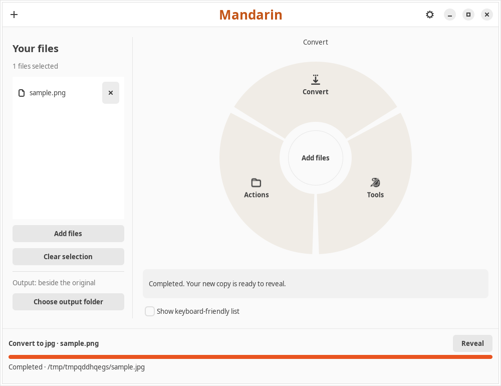

# Mandarin

Mandarin is a local Ubuntu file converter with a context-aware radial menu. Drag into a category, hold to open its submenu, and release over a conversion. Tools open parameter forms with local image previews. A grouped list provides keyboard access to the same operations.

**0.1.0 is a testing preview for Ubuntu 24.04 amd64. Full Tangerine parity is not certified.** See the [implementation report](.aiwg/reports/implementation-0.1.0.md) and [implementation decision](.aiwg/architecture/ADR-006-native-implementation.md).

[**Download the Ubuntu installer**](https://github.com/robit-man/mandarin/releases/download/v0.1.0/mandarin_0.1.0_amd64.deb)

Open the downloaded `.deb` with Ubuntu App Center and choose **Install**. Ubuntu handles administrator authentication; all conversion tooling and the taskbar indicator are included. Launch Mandarin from Applications. The indicator can reopen the window, add files, show conversion jobs and quit; closing the window keeps conversions available through the indicator.



Snap Store: `mandarin` is registered and revision 1 is submitted for edge publication. Canonical reports `ReviewInProgress`; Store installation is pending approval. The public `.deb` above is available now. See the [submission record](packaging/STORE-LISTING.md).

The command-line alternative is:

```bash
sudo apt install ./dist/mandarin_0.1.0_amd64.deb
mandarin
```

The package includes its own Python/GTK runtime, FFmpeg codecs, ImageMagick and HEIC/AVIF plugins, LibreOffice filters, Pandoc data, PDF engines, archive support, ExifTool/Perl, OCR and face-detection data, fonts and icons. Users do not install conversion tools or download first-run assets. Engine paths are fixed inside the package. Versions/file hashes are in `dist/runtime-manifest.json`. Allow approximately 2.1 GiB installed space plus conversion workspace. Ubuntu desktop and a kernel with Landlock ABI 3 or later are required.

Use Add files, drag/drop or Open With. Outputs receive new names beside each original or in a chosen folder; existing files are never overwritten. Local history retains interrupted jobs for explicit retry. Move retains a verified recovery copy in the source volume.

```bash
mandarin --health
mandarin --convert webp --output "$HOME/Pictures/converted" photo.png
mandarin --tool resize --options '{"width":800,"height":600}' photo.png
```

The bundled GNOME 46 companion provides global invocation hooks: Shift for Convert, Control for Tools and Alt for Actions during a file drag. After installation, sign out/in so GNOME discovers it, then use Package health → Enable GNOME companion, or GNOME Extensions. Global Wayland behavior remains a qualification gate; the standalone drag surface works independently. Nearby Share sends to a consenting LocalSend recipient over certificate-pinned TLS; verify the shown fingerprint first.

Build on Ubuntu 24.04:

```bash
sh scripts/bootstrap-build.sh
make run
make test integration gui
python3 -m unittest discover -s tests -v
make package
```

Packaging requires a running Docker daemon and the official `ubuntu:24.04` image already present. The builder stages the explicit Debian dependency closure, verifies runtime hashes, installs the actual `.deb` in clean Ubuntu with networking disabled and executes the conversion corpus and tool checks as an unprivileged user. A failing check fails the build. See [package roots](packaging/runtime-packages.json), [builder](scripts/build_package.py) and [offline verifier](scripts/verify_package.py).

Known gaps include native Pages output, unqualified Pages/RTFD/textClipping input, editable PDF reconstruction, advanced editor modes and full GNOME/portal/source-app coverage. Current PDF text export extracts embedded text, without OCR for scans. Recognition smoke checks do not certify face/text detection recall. This preview is unsigned. Bundled notices and matching source-package archives are provided; see [third-party software](THIRD-PARTY.md).

Start with these documents:

| Document | Purpose |
| --- | --- |
| [Delivery plan](PLAN.md) | Scope, milestones, dependencies, estimates, and release gates |
| [SOP](SOP.md) | Repeatable research, development, verification, packaging, and release procedures |
| [Feature review](.aiwg/research/reports/tangerine-feature-review.md) | What public Tangerine sources establish and what still needs hands-on validation |
| [Requirements](.aiwg/requirements/srs.md) | Radial behavior, context rules, job safety, and measurable acceptance criteria |
| [Architecture](.aiwg/architecture/sad.md) | Ubuntu integration, process boundaries, engines, and packaging decisions |
| [Test plan](.aiwg/testing/test-plan.md) | Conversion, interaction, desktop, safety, and package verification |
| [Risk register](.aiwg/risks/risk-register.md) | Blocking uncertainties, owners, experiments, and fallback decisions |
| [Conversion matrix](.aiwg/requirements/conversion-matrix.csv) | All 275 directed conversion pairs from the public simulated demo |
| [Parity inventory](.aiwg/requirements/parity-inventory.json) | Machine-readable routes, 26 tools, QR reading, and six actions |

The largest early risks are global drag interaction on GNOME Wayland, native Pages output, PDF reconstruction quality, and packaging every engine for offline use. They are explicit release gates. A drop-zone-only build is useful for testing, but does not satisfy the global-gesture requirement.

Validate the planning package with Python 3, without installing dependencies:

```bash
python3 scripts/validate_plan.py
```

This validates documentation and inventory consistency; it does not test an application. The comparison baseline comes from [Tangerine's product page](https://tangerineformac.com/), [tools page](https://tangerineformac.com/tools), and [App Store listing](https://apps.apple.com/us/app/tangerine-file-converter/id6813034065?mt=12). No vendor source code, artwork, or binary is included.
